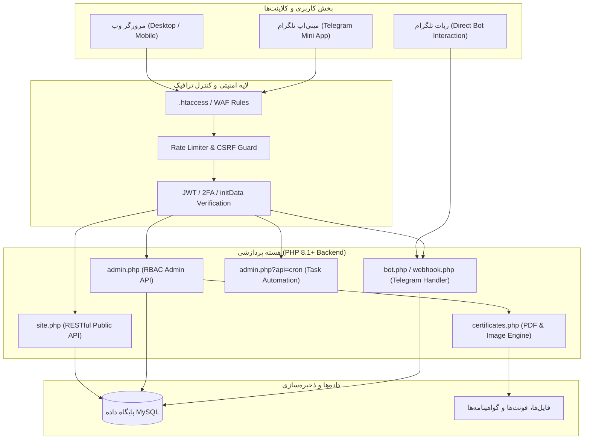

# ⚡ سامانه جامع و هوشمند انجمن علمی برق و کامپیوتر (SSAEE Panel)

<div align="center">


**پلتفرم یکپارچه مدیریت انجمن علمی: پورتال وب، مینی‌اپ تلگرام (TMA)، پنل ادمین ماژولار و بات هوشمند ارتباط با دانشجویان**

[قابلیت‌های کلیدی](#-قابلیت‌های-کلیدی) •
[معماری سیستم](#-معماری-سیستم) •
[راهنمای نصب](#-راهنمای-نصب-و-راه‌اندازی) •
[پیکربندی محیطی](#-پیکربندی-تنظیمات-env) •
[تنظیم ربات تلگرام](#-راه‌اندازی-ربات-و-وب‌هوک-تلگرام) •
[ماتریس دسترسی](#-ماتریس-دسترسی-و-نقش‌های-مدیریتی)

---

</div>

## 📖 معرفی سامانه

**SSAEE Smart Panel** یک سیستم یکپارچه، سبک و پرسرعت برای مدیریت تشکل‌ها، انجمن‌های علمی و نهادهای دانشجویی است که بر پایه معماری ماژولار PHP 8.1+ طراحی شده است. 

این پلتفرم علاوه بر وب‌سایت عمومی رسپانسیو، به صورت مستقیم در بستر **Telegram Mini App** قابل استفاده بوده و دارای پنل مدیریت جامع چندنقشی (RBAC)، ربات تلگرام پیشرفته با سامانه پشتیبانی و تیکتینگ دکمه شیشه‌ای، ماژول صدور گواهی و کارت عضویت و سیستم خودکارسازی یادآوری کارگاه‌ها می‌باشد.

---

## 🌟 قابلیت‌های کلیدی

### 🌐 پورتال کاربران و مینی‌اپ تلگرام (User Portal & TMA)
* **تجربه کاربری یکپارچه:** اجرای همزمان به عنوان وب‌سایت مدرن SPA و تلگرام مینی‌اپ با اعتبارسنجی مستقیم `initData`.
* **ورود امن با شماره موبایل:** امکان احراز هویت با شماره تلفن همراه و اتصال مستقیم حساب وب به تلگرام بدون نیاز به حفظ پسوردهای پیچیده.
* **ثبت‌نام هوشمند کارگاه‌ها:** پیش‌پر کردن خودکار فرم‌ها برای کاربران لاگین‌شده و تفکیک دانشجویان دانشگاه با سایر دانشگاه‌ها.
* **اسلایدر و بنرهای تبلیغاتی پویا:** اسلایدشوی روان با کنترل نرخ چرخش، تعریف کد کوتاه، تاریخ انقضا و بازه زمانی انتشار.
* **ویترین اعضای هیئت مدیره:** معرفی دوره‌های انجمن و اساتید مشاور به همراه رزومه، شبکه‌های اجتماعی و تصاویر اختصاصی.
* **گزارش تصویری فعالیت‌ها:** مشاهده رویدادهای پیشین، نظرسنجی‌ها و امتیازات باشگاه پژوهشگران.

### 🛡️ پنل مدیریت هوشمند و پویا (Modern Admin SPA)
* **داشبورد تحلیلی با Chart.js:** نمایش نمودارهای آماری ثبت‌نام ۱۴ روز اخیر، وضعیت پرداخت‌ها و سلامت سرویس.
* **پشتیبانی کامل از تم روشن و تاریک (Dark/Light):** رابط کاربری واکنش‌گرا با قابلیت ذخیره تنظیمات ظاهری کاربر.
* **سایدبار ماژولار جمع‌شونده (Collapsible):** تجربه کاربری ارگونومیک در دسکتاپ و دستگاه‌های لمسی.
* **جستجو و فیلتر پیشرفته زنده:** جستجوی آنی بدون رفرش صفحه بر روی تمامی جداول دیتابیس به صورت ایمن.
* **خروجی چاپی و PDF مستقیم:** قالب‌بندی استاندارد خروجی PDF تمیز از جداول و گزارشات ثبت‌نامی‌ها.
* **لاگ تمام‌عیار ممیزی (Audit Trail):** ثبت کلیه کنش‌های مدیران با آدرس IP، زمان دقیق و مشخصات مرورگر.

### 🤖 ربات هوشمند و سیستم پشتیبانی تعاملی (Telegram Bot & Support)
* **پشتیبانی زنده با دکمه‌های شیشه‌ای (Inline Keyboards):** ارسال تیکت توسط کاربر با نمایش پیش‌نمایش اطلاعات اشتراک‌گذاری‌شده.
* **پاسخ مستقیم پشتیبانان:** امکان پاسخگویی ادمین‌ها به پیام‌های کاربران مستقیماً از داخل تلگرام با حفظ حریم خصوصی دوطرفه.
* **ابزار مدیریت وب‌هوک مبتنی بر مرورگر:** بدون نیاز به ترمینال SSH یا خط فرمان؛ تنظیم، بازرسی، حذف و تست Round-trip وب‌هوک مستقیماً از پنل.
* **تایید هویت دو مرحله‌ای (2FA):** ارسال کد ورود یکبار مصرف به تلگرام مدیر هنگام لاگین به پنل ادمین.

### 📜 موتور صدور گواهینامه و کارت عضویت (Certificate & Membership Engine)
* **طراحی پویا روی تمپلت:** تعیین موقعیت مکانی المان‌ها (نام، کد ملی، تاریخ، امضا، بارکد QR) با دقت پیکسلی.
* **تولید خودکار گواهی:** اتصال خودکار امضا و مهر دبیر انجمن بر اساس دوره تصدی و رسم روی گواهینامه‌ها.
* **رندرینگ دوگانه:** پشتیبانی از خروجی تصویر کیفیت بالا (GD) و پشتیبانی از رندر ابری PDF (Browserless API).

### ⏱️ زمان‌بندی و اتوماسیون (Cron Jobs)
* **یادآوری چندمرحله‌ای کارگاه‌ها:** ارسال خودکار پیام تلگرامی و لینک ورود به کلاس در فواصل زمانی (۲ ساعت و ۷۵ دقیقه قبل از شروع).
* **مدیریت ظرفیت و مهلت:** بستن خودکار فرم‌های ثبت‌نام بلافاصله پس از آغاز جلسه نخست.
* **نظرسنجی هوشمند:** ارسال خودکار فرم ارزیابی رضایت پس از پایان جلسه بدون نیاز به اقدام دستی ادمین.

---

## 🏗 معماری سیستم



---

## 📂 ساختار پوشه‌ها و فایل‌ها

```text
├── admin/                     # ماژول پنل مدیریت
│   ├── assets/                # استایل‌ها و اسکریپت‌های پنل ادمین (Chart.js, Lucide)
│   ├── app.html               # شل رابط کاربری تک‌صفحه‌ای (SPA) پنل مدیریت
│   ├── index.php              # نقطه ورود و Dispatcher پنل ادمین
│   └── .htaccess              # هدایت مسیرهای API مدیریت
├── assets/                    # دارایی‌های عمومی سایت
│   ├── board/                 # تصاویر اعضای هیئت مدیره
│   ├── cert-template/         # قالب‌های تصویر گواهینامه‌ها
│   ├── fonts/                 # فونت‌های وب استاندارد (YekanBakh, Vazirmatn)
│   ├── vendor/                # کتابخانه‌های کلاینت (Lucide Icons)
│   ├── app.css                # استایل‌های اصلی پورتال کاربران
│   └── app.js                 # منطق کلاینت و ارتباط با سرور
├── bot/                       # کنسول تحت‌وب مدیریت ربات تلگرام
│   ├── status.php             # داشبورد مشاهده وضعیت توکن، شناسه و وب‌هوک
│   ├── set.php                # ثبت و فعال‌سازی فوری Webhook
│   ├── delete.php             # حذف وب‌هوک تلگرام
│   ├── test.php               # تست رفت‌وبرگشت پیام و اتصال به API تلگرام
│   └── webhook.php            # اندپوینت اختصاصی و سبک دریافت درخواست‌های تلگرام
├── includes/                  # منطق تجاری و هسته بک‌اند
│   ├── bootstrap.php          # هسته مشترک (اتصال PDO، مدیریت محیط، توکن‌های JWT و ابزارهای عمومی)
│   ├── site.php               # متدهای اختصاصی پورتال عمومی و کاربران
│   ├── admin.php              # متدهای پردازشی پنل ادمین و مجوزهای RBAC
│   ├── bot.php                # منطق مکالمات، هندلرهای تلگرام و سیستم تیکتینگ
│   ├── certificates.php       # موتور پردازش و تولید فایل‌های گواهینامه
│   └── maintenance.php        # میدل‌ور وضعیت در دست تعمیر سامانه
├── install/                   # نصب‌کننده خودکار اولیه سامانه
│   ├── index.php              # رابط کاربری وب راه‌اندازی گام‌به‌گام
│   ├── schema.sql             # اسکیمای کامل و پیش‌فرض دیتابیس MySQL
│   └── quickfix.sql           # اسکریپت اصلاحی ستون‌ها برای به‌روزرسانی
├── storage/                   # ذخیره‌سازی داده‌های محافظت‌شده
│   ├── cache/                 # کش موقت داده‌ها
│   ├── certificates/          # فایل‌های گواهی صادر شده (با محدودیت دسترسی کامل)
│   └── logs/                  # لاگ‌های سامانه و رویدادهای تلگرام
├── tests/                     # سوئیت تست و اعتبارسنجی پروژه
│   └── verify_audit.py        # اسکریپت بررسی امنیت، صحت فایل‌ها و استانداردهای کد
├── .env.example               # نمونه فایل پیکربندی متغیرهای محیطی
├── .htaccess                  # پیکربندی سرور آپاچی، هدرهای امنیتی و قوانین کش
├── app.html                   # کلاینت SPA پورتال کاربران
├── error.php                  # صفحه خطاهای عمومی سرور (403, 404, 500, ...)
├── index.php                  # روت اصلی سامانه و توزیع‌کننده درخواست‌ها
├── migrate.php                # ابزار مهاجرت پایگاه داده با قابلیت پیش‌نمایش زنده
├── robots.txt                 # قوانین خزش موتورهای جستجو
├── setup.php                  # اسکریپت تعریف نخستین سوپرادمین
└── sitemap.xml                # نقشه سایت
```

---

## 📋 نیازمندی‌های سیستم

* **PHP:** نسخه 8.1 یا بالاتر
* **اکستنشن‌های الزامی PHP:**
  * `pdo_mysql` (ارتباط با پایگاه داده)
  * `curl` (ارتباط با سرورهای تلگرام و رندر ابری)
  * `gd` یا `imagick` (برای ماژول صدور گواهینامه و کارت)
  * `mbstring` و `json` (پردازش رشته‌ها و وب‌سرویس‌ها)
* **پایگاه داده:** MySQL 5.7+ یا MariaDB 10.3+
* **وب‌سرور:** Apache (با `mod_rewrite` و `mod_headers`) یا Nginx

---

## 🚀 راهنمای نصب و راه‌اندازی

### روش ۱: استفاده از نصب‌کننده خودکار وب (پیشنهادی)

1. **انتقال فایل‌ها:** محتویات پروژه را در دایرکتوری ریشه وب‌سرور (`public_html` یا روت هاست) قرار دهید.
2. **ورود به صفحه نصب:** با مرورگر به مسیر `https://your-domain.com/install/` مراجعه نمایید.
3. **تکمیل اطلاعات فرم:**
   * مشخصات دیتابیس (نام پایگاه داده، نام کاربری و پسورد)
   * نام کاربری و رمز عبور حساب مدیر ارشد اولیه (Superadmin)
   * شناسه عددی تلگرام مدیر (اختیاری جهت دریافت کدهای 2FA)
   * توکن ربات تلگرام (دریافتی از BotFather)
4. دکمه **«نصب و راه‌اندازی»** را بزنید. سیستم خودکار فایل `.env` را ساخته، جداول دیتابیس را مستقر کرده و فایل قفل نصب (`install.lock`) ایجاد می‌کند.
5. **نکته امنیتی:** پوشه `install/` را پس از تکمیل نصب حذف نمایید.

---

### روش ۲: راه‌اندازی دستی (Manual Setup)

1. **ایجاد دیتابیس:** در پنل phpMyAdmin یا خط فرمان MySQL یک دیتابیس با انکودینگ `utf8mb4_unicode_ci` بسازید:
   ```sql
   CREATE DATABASE ssaee_database CHARACTER SET utf8mb4 COLLATE utf8mb4_unicode_ci;
   ```
2. **درون‌ریزی اسکیما:** فایل موجود در مسیر `install/schema.sql` را درون دیتابیس ایمپورت (Import) کنید.
3. **تنظیم فایل محیطی:** فایل `.env.example` را به `.env` کپی کنید:
   ```bash
   cp .env.example .env
   ```
   سپس اطلاعات دیتابیس و کلیدهای امنیتی را در آن پر کنید.
4. **ایجاد حساب اولین مدیر:** به مسیر `https://your-domain.com/setup.php` رفته و حساب ادمین ارشد را تعریف کنید. (پس از ایجاد اولین کاربر، این صفحه به طور خودکار غیرفعال می‌شود؛ با این حال جهت ارتقای امنیت، فایل `setup.php` را حذف فرمایید).

---

## ⚙️ پیکربندی تنظیمات (`.env`)

| متغیر | مقدار پیش‌فرض | توضیحات |
|---|---|---|
| `APP_ENV` | `production` | وضعیت محیط اجرایی (`production` یا `development`) |
| `APP_DEBUG` | `0` | فعال/غیرفعال‌سازی نمایش گزارش خطاهای دقیق |
| `APP_URL` | `https://your-domain.com` | آدرس دامنه اصلی متصل به سامانه |
| `APP_TIMEZONE` | `Asia/Tehran` | منطقه زمانی پیش‌فرض برنامه |
| `DB_HOST` | `localhost` | آدرس سرور پایگاه داده |
| `DB_PORT` | `3306` | پورت اتصال MySQL |
| `DB_NAME` | `your_db_name` | نام پایگاه داده |
| `DB_USER` | `your_db_user` | نام کاربری دیتابیس |
| `DB_PASS` | `your_db_password` | رمز عبور دیتابیس |
| `JWT_SECRET` | *(رشته ۶۴ کاراکتری تصادفی)* | کلید رمزنگاری تولید توکن‌های امضاشده JWT |
| `APP_SECRET` | *(رشته تصادفی)* | کلید محرمانه عمومی برنامک |
| `TELEGRAM_BOT_TOKEN` | *(از تلگرام)* | توکن دسترسی بات تلگرام از `@BotFather` |
| `TELEGRAM_ADMIN_CHAT_ID` | *(عدد)* | آیدی عددی تلگرام مدیر ارشد جهت هشدارهای سیستمی و 2FA |
| `TELEGRAM_WEBHOOK_SECRET` | *(رشته تصادفی)* | هدر امنیتی `X-Telegram-Bot-Api-Secret-Token` |
| `TELEGRAM_BOT_USERNAME` | `ssaee_bot` | نام کاربری ربات بدون `@` |
| `CRON_SECRET` | `change_me_random_secret` | توکن امنیتی فراخوانی وظایف زمان‌بندی‌شده Cron |
| `ADMIN_2FA_ENABLED` | `1` | فعال‌سازی احراز هویت دو مرحله‌ای ورود مدیران |

> [!TIP]
> برای تولید رشته‌های تصادفی با امنیت بالا برای متغیرهای `JWT_SECRET` و `APP_SECRET` می‌توانید از دستور PHP زیر استفاده کنید:
> ```bash
> php -r "echo bin2hex(random_bytes(32)) . PHP_EOL;"
> ```

---

## 🤖 راه‌اندازی ربات و وب‌هوک تلگرام

این سامانه دارای کنسول اختصاصی در مسیر `/bot/` است که شما را از اجرای کدهای ترمینالی بی‌نیاز می‌کند:

1. وارد پنل مدیریت شده و از سایدبار گزینه **«ابزار ربات تلگرام»** را انتخاب کنید (یا مستقیماً به `/bot/status.php` بروید).
2. وضعیت توکن و اطلاعات دریافتی ربات را بررسی نمایید.
3. بر روی دکمه **«ثبت وب‌هوک»** کلیک کنید تا اندپوینت `/bot/webhook.php` همراه با توکن سکرت با موفقیت بر روی سرورهای تلگرام رجیستر شود.
4. با فشردن دکمه **«تست اتصال»**، یک چرخه کامل ارتباطی را ارزیابی کنید.

### ثبت دستی وب‌هوک (در صورت تمایل):
```bash
curl -F "url=https://your-domain.com/bot/webhook.php" \
     -F "secret_token=YOUR_TELEGRAM_WEBHOOK_SECRET" \
     https://api.telegram.org/botYOUR_BOT_TOKEN/setWebhook
```

---

## ⏱️ زمان‌بندی و وظایف خودکار (Cron Job)

جهت ارسال خودکار یادآورهای کلاسی، نظرسنجی‌ها و بستن مهلت ثبت‌نام‌ها، تسک کران‌جاب زیر را در کنترل‌پنل هاست خود (مانند cPanel یا DirectAdmin) تنظیم کنید تا **هر ۵ دقیقه یک‌بار** اجرا شود:

```bash
*/5 * * * * curl -s "https://your-domain.com/admin/index.php?api=cron&secret=YOUR_CRON_SECRET" > /dev/null 2>&1
```

یا از طریق CLI پی‌اچ‌پی:
```bash
*/5 * * * * /usr/local/bin/php -f /path/to/public_html/admin/index.php api=cron secret=YOUR_CRON_SECRET > /dev/null 2>&1
```

### گاه‌شمار خودکار رویدادها:
* **۲ ساعت پیش از جلسه:** ارسال اعلان یادآوری و لینک ورود به کلاس برای کلیه شرکت‌کنندگان متصل به تلگرام.
* **۷۵ دقیقه پیش از جلسه:** ارسال پیام هشدار نهایی جلسه.
* **شروع اولین جلسه:** بستن خودکار فرم ثبت‌نام کارگاه و تغییر وضعیت ظرفیت.
* **۴ ساعت پس از پایان هر جلسه:** توزیع هوشمند فرم نظرسنجی و ارزیابی کیفیت دوره بین حاضرین.

---

## 🛡 ماتریس دسترسی و نقش‌های مدیریتی

سیستم کنترل دسترسی بر پایه نقش (RBAC) طراحی شده و هر مدیر می‌تواند دارای یک یا چند نقش همزمان باشد:

| نقش کاربری | کلید شناسه | محدوده دسترسی‌ها |
|---|---|---|
| **مدیر فنی** | `tech_admin` | مدیریت سرور، تنظیمات وب‌هوک تلگرام، ابزار مایگریشن دیتابیس و پیکربندی سطح پایین |
| **مدیر ارشد** | `superadmin` | دسترسی نامحدود به کلیه بخش‌ها، مدیریت مدیران، تنظیمات عمومی و بررسی لاگ ممیزی |
| **مدیر کارگاه‌ها** | `workshops_admin` | مدیریت کارگاه‌ها، جلسات، کلاس‌ها، ثبت‌نامی‌ها و اطلاعیه‌ها |
| **مدیر گواهینامه‌ها** | `cert_admin` | پیکربندی قالب‌ها، صدور و لغو گواهینامه‌ها و کارت‌های عضویت |
| **مدیر اعضا** | `members_admin` | مدیریت پایگاه داده اعضای انجمن و بررسی فرم‌های درخواست عضویت |
| **مدیر روابط عمومی** | `associations_admin` | ارتباط با اساتید، اسپانسرها، شرکت‌های همکار، پیام‌های دریافتی و گزارش فعالیت‌ها |
| **ادمین بنرها** | `banners_admin` | ایجاد، زمان‌بندی و مدیریت بنرهای اسلایدر صفحه اصلی |

---

## 🔒 استانداردهای امنیتی اعمال‌شده

* **حفاظت در برابر حملات تزریق (SQL Injection):** استفاده ۱۰۰ درصدی از Prepared Statements در لایه PDO دیتابیس.
* **اعتبارسنجی CSRF:** صدور و راستی‌آزمایی توکن‌های یکبارمصرف برای تمامی درخواست‌های تغییردهنده وضعیت (POST).
* **محدودسازی نرخ درخواست (Rate Limiting):** حفاظت از اندپوینت‌های حساس در برابر حملات Brute-Force و DoS.
* **جلوگیری از XSS:** پالایش و Escape کامل ورودی‌های کاربران در فرانت‌اند با ۵ کاراکتر استاندارد HTML (`&`, `<`, `>`, `"`, `'`).
* **دیواره امنیتی `.htaccess`:** مسدودسازی قطعی دسترسی عمومی به فایل‌های `.env`، دایرکتوری‌های داخلی (`includes/`, `storage/`, `install/`)، لاگ‌ها و بکاپ‌ها.
* **الگوریتم‌های رسمی اعتبارسنجی:** چک دقیق صحت رقم کنترلی کد ملی ۱۰ رقمی ایران و فرمت شماره موبایل.

---

## 🧪 تست و اعتبارسنجی خودکار

سامانه دارای یک سوئیت تست پایتون برای ارزیابی پیوسته موازین امنیتی و یکپارچگی فایل‌ها است:

```bash
python tests/verify_audit.py
```

این تست موارد زیر را به صورت خودکار بررسی می‌کند:
* عدم وجود فایل‌های دیباگ، لاگ یا فایل‌های موقت پرخطر
* صحت کامل رول‌های امنیتی فایل‌های `.htaccess`
* سلامت و ترتیبات امنیتی کنترلرهای Cron و Whitelist ستون‌ها
* استاندارد WCAG 1.4.4 و تگ‌های متای SEO در فرانت‌اند

---

## 🤝 مشارکت و توسعه

از مشارکت شما در ارتقا، بازبینی یا رفع باگ‌های این سامانه استقبال می‌کنیم:
1. پروژه را Fork کنید.
2. یک شاخه ویژگی جدید بسازید (`git checkout -b feature/NewFeature`).
3. تغییرات خود را Commit کنید (`git commit -m 'Add awesome feature'`).
4. شاخه را Push کنید (`git push origin feature/NewFeature`).
5. یک Pull Request ارسال فرمایید.

---

## 📄 لایسنس

این پروژه تحت لایسنس [MIT](LICENSE) منتشر شده است. استفاده، شخصی‌سازی و توسعه آن برای تمامی تشکل‌ها و انجمن‌های دانشگاهی آزاد است.
